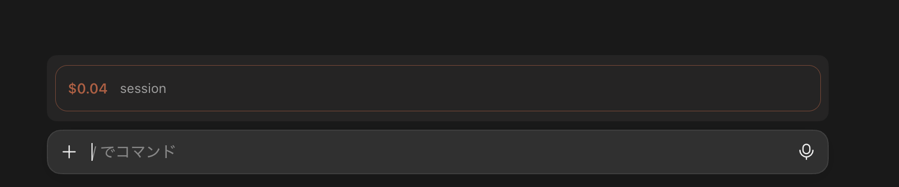

Claude Code の mod（プラグイン）を使うと、セッションのコストを入力欄の上に常に表示できます。この記事で作る mod「session-cost」は、4 つのファイルと `~/.claude/settings.json` への 1 行の追加で動き、Sonnet 以外のモデルを使っているときは警告も出します。Claude Code 2.1.325 で動作を確認しました（2026 年 11 月時点）。

## 課題：コストと使用中のモデルが、作業中に見えない

Claude Code を使っていて、次の 2 つに困っていました。

- いまのセッションでいくら使ったかが、`/cost` で確認しないと分からない
- 普段は Sonnet を使っているのに、気づかないうちに Opus などの高いモデルに切り替わっていることがある

どちらも、作業中に常に見えていれば防げます。そこで、Claude Code の画面に表示を足せる mod を作りました。

## できること：コストの常時表示と、モデルの警告

session-cost を入れると、次の 3 つができるようになります。

| 機能 | 表示する場所 | タイミング |
|---|---|---|
| セッションのコスト（USD）を表示する | 入力欄の上の帯 | セッションの開始時と、応答が終わるたび |
| Sonnet 以外のモデルのとき、枠を警告色にして「Sonnet ではありません」と表示する | 入力欄の上の帯 | 常時 |
| モデルが Sonnet 以外に切り替わったことを知らせる | トースト（一時的な通知） | 切り替え後、最初にメッセージを送ったとき（モデルを呼び出す前） |

Sonnet で使っているときは、次のように入力欄の上にコストだけが出ます。



## 実施手順：4 つのファイルを置き、settings.json で読み込む

別の端末に入れるときも、この手順で同じ状態にできます。

**前提**

- Claude Code 2.1.325 で確認しています。mod の API は早期アクセス版で、今後のリリースで変わる可能性があります
- mod は TypeScript（TSX）で書きます。ビルドは不要で、Claude Code がそのまま読み込みます
- 作業は macOS を想定しています（パスの例が `/Users/...` です）

### 1. フォルダとファイルを作る

mod は次の 4 つのファイルでできています。

```bash
mkdir -p ~/.claude/dev-mods/session-cost/.claude-plugin ~/.claude/dev-mods/session-cost/hooks ~/.claude/dev-mods/session-cost/types
```

```text
~/.claude/dev-mods/session-cost/
├── .claude-plugin/plugin.json   … mod の名前と説明
├── hooks/hooks.json             … 読み込むモジュールの指定
├── hooks/register.tsx           … 本体
└── types/index.d.ts             … mod が保存する状態の型
```

#### .claude-plugin/plugin.json

mod の名前・バージョン・説明と、状態の型を書いたファイルの場所を指定します。

```json
{ "name": "session-cost", "version": "0.1.0", "description": "セッションのコストを入力欄の上に出し、Sonnet 以外のモデルなら警告する", "types": "./types/index.d.ts" }
```

#### hooks/hooks.json

本体のモジュールを指定します。

```json
{ "modules": ["./register.tsx"] }
```

#### types/index.d.ts

mod が保存する状態（コストとモデル名）の型を宣言します。まだ取得していないことは `null` で表します。

```ts
declare module 'claude-code' {
  interface PluginState {
    'session-cost': { usd: number | null; model: string | null }
  }
}
```

#### hooks/register.tsx

本体です。4 つのイベントにフックしています。

| イベント | いつ | やること |
|---|---|---|
| `session.start` | セッションの開始時 | コストとモデルの初期値を読む |
| `session.measure` | 応答が終わり、エンジンが使用量を計測したとき | 渡されたコストで表示を更新する |
| `turn.start` | モデルを呼び出す直前 | モデルを確認し、Sonnet 以外に変わっていればトーストを出す |
| `ui.render`（`AbovePrompt`） | 入力欄の上の帯を描くとき | コストと、Sonnet 以外なら警告を描く |

```tsx
import { atom, read, update } from 'claude-code'
import type { EngineInterface, Register } from 'claude-code'

// セッションのコスト（USD）。null は未取得。
const usd = atom({ plugin: 'session-cost', key: 'usd' } as const, null)
// 直前に確認したモデル。null は未取得。
const model = atom({ plugin: 'session-cost', key: 'model' } as const, null)

// 普段使うモデルは Sonnet。それ以外（Opus, Haiku など）で警告する。
const isSonnet = (name: string): boolean => name.toLowerCase().includes('sonnet')

export const register: Register = on => {
  on('session.start', async ($, e, next) => {
    const { cost } = await $.session.usage()
    await update($, usd, () => cost?.usd ?? null)
    await checkModel($)

    return next(e)
  })

  // 応答が終わるたびにエンジンが送ってくる計測値から、コストを更新する。
  on('session.measure', async ($, e, next) => {
    if (e.cost !== undefined) {
      const value = e.cost.usd
      await update($, usd, () => value)
    }

    return next(e)
  })

  // モデルの呼び出し前に確認し、/model で切り替えた直後でも費用がかかる前に知らせる。
  on('turn.start', async ($, e, next) => {
    if (e.agentId === undefined) {
      await checkModel($)
    }

    return next(e)
  })

  // 入力欄の上の帯に、コストと、Sonnet 以外のときは警告を出す。
  on('ui.render', { component: 'AbovePrompt' }, async ($, e, next) => {
    const value = await read($, usd)

    if (e.props.hasSurvey || value === null) {
      return next(e)
    }
    const current = await read($, model)
    const isOff = current !== null && !isSonnet(current)
    const { Box, Text } = $.ui.resolve(e)

    return (
      <Box
        flexDirection="row"
        alignItems="center"
        gap="sm"
        paddingX="md"
        borderStyle="round"
        borderColor={isOff ? 'warning' : 'claude'}
        borderDimColor={!isOff}
      >
        <Text color="claude" weight="semibold">${value.toFixed(2)}</Text>
        <Text color="subtle" size="footnote">session</Text>
        {isOff ? <Text color="warning" weight="semibold">⚠ {current}（Sonnet ではありません）</Text> : null}
      </Box>
    )
  })
}

// モデルを読み直し、Sonnet 以外に変わったときだけトーストで知らせる。
async function checkModel($: EngineInterface): Promise<void> {
  const current = await $.session.model()
  const previous = await read($, model)
  await update($, model, () => current)

  if (current !== previous && !isSonnet(current)) {
    $.ui.toast(`モデルが ${current} になっています（Sonnet ではありません）`)
  }
}
```

実装のポイントは次の 5 つです。

- **コストは `session.measure` で受け取る**: エンジンが応答のたびに計測値を渡してくれるので、自分で `$.session.usage()` を呼び直す必要がありません
- **モデルは `turn.start` で確認する**: 応答が終わってから確認すると、`/model` で切り替えたあとの最初の応答には、警告が出る前に高いモデルの料金がかかってしまいます。モデルを呼ぶ直前に確認すれば、料金がかかる前に気づけます。サブエージェントのターン（`e.agentId` がある）は対象外にしています
- **アンケートが出ているときは譲る**: 入力欄の上の帯には Claude Code のアンケートも出ます。`e.props.hasSurvey` が true のときは何も描かずに `next(e)` を返します
- **「未取得」は `null` で表す**: `-1` や `''` のような特別な値を使うより、型で区別できるので安全です
- **色はテーマの名前で指定する**: `'claude'` `'warning'` `'subtle'` を使っているので、ライト・ダークどちらのテーマでも読める色になります

警告の対象を変えたいときは、`isSonnet` の判定を書き換えます。たとえば Haiku も許可するなら、`name.toLowerCase()` に `haiku` が含まれる場合も true を返すようにします。

### 2. ~/.claude/settings.json を編集する

既存の項目は消さずに、次の 2 点を追加・変更します。

- `"env"` の中に `"CLAUDE_CODE_PLUGIN_DIRS": "/Users/<ユーザー名>/.claude/dev-mods/session-cost"` を追加する。`<ユーザー名>` の部分は、その端末のホームディレクトリに合わせます（`echo $HOME` で確認できます）
- 既定のモデルを Sonnet にする場合は `"model": "sonnet"` にする

```json
{
  "model": "sonnet",
  "env": {
    "CLAUDE_CODE_PLUGIN_DIRS": "/Users/<ユーザー名>/.claude/dev-mods/session-cost"
  }
}
```

書いたら、JSON として読めるかを確認します。

```bash
python3 -c "import json; d=json.load(open('$HOME/.claude/settings.json')); print('OK', d.get('model'), d['env'].get('CLAUDE_CODE_PLUGIN_DIRS'))"
```

### 3. claude plugin validate で検証する

```bash
claude plugin validate ~/.claude/dev-mods/session-cost
```

「Validation passed」と出れば成功です。README・LICENSE・アイコンがないといった警告は、プラグインのディレクトリに公開するときに必要なもので、ローカルで使うだけなら無視して構いません。

### 4. 新しいセッションで表示を確認する

設定は、新しく開始したセッションから反映されます。新しいセッションで、入力欄の上に「$x.xx session」が出ていれば完了です。Sonnet 以外のモデルに切り替えると、次に送信したときにトーストが出て、枠が警告色になり、モデル名と「Sonnet ではありません」が表示されます。

表示されないときは、次の順に確認します。

1. 設定を書いたあとに、新しいセッションを開始したか（実行中のセッションには反映されません）
2. `CLAUDE_CODE_PLUGIN_DIRS` が、mod のフォルダを指す絶対パスになっているか（`~` は使わない）
3. `claude plugin validate` がエラーなく通るか
4. `claude --debug` で起動し、デバッグログに mod のフックの失敗が出ていないか

## 終わりに

コストが常に目に入るだけで、「この調べものに Opus は要らないな」と判断しやすくなりました。mod は TSX で入力欄まわりの表示を差し替えられるので、作業中に見ておきたい情報があれば、同じ形で足していけます。

この記事のポイントをまとめます。

- Claude Code の mod は、`ui.render` で入力欄の上の帯（`AbovePrompt`）に任意の表示を足せる
- セッションのコストは `session.measure` イベントで、応答のたびに受け取れる
- モデルの確認は `turn.start` で行うと、料金がかかる前に警告できる
