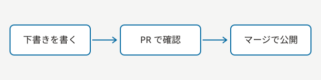

この記事は、ブログ記事の書き方を示すためのサンプルです。内容は仮の文章です。

## 見出しは ## から始める

記事のタイトルは frontmatter の `title` がページの見出し（h1）になるので、本文の見出しは `##` から始めます。

## 本文は素の Markdown で書く

後から別のサービスへ転載できるよう、本文は一般的な Markdown だけで書きます。生の HTML やサイト独自の部品は使いません。

- 箇条書き
- **強調**
- [リンク](https://docs.astro.build/)

```bash
npm run dev
```

## 画像は代替テキストを必ず書く

画像は `src/content/blog/images/<記事のファイル名>/` に置き、本文から相対パスで参照します。`![ ]` の中の代替テキストを空にするとビルドが失敗します。


